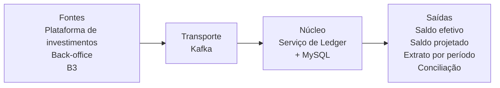

# Conta Corrente Virtual de Investimentos

Proposta de arquitetura para uma conta corrente de investimentos que mostra **dois saldos confiáveis** ao mesmo tempo:

- **Saldo efetivo:** só o que já foi liquidado (o dinheiro que de fato entrou ou saiu).
- **Saldo projetado:** o saldo numa data futura, somando também o que ainda vai liquidar (provisionado).

Os dois saldos precisam ser **auditáveis** (dá para explicar cada centavo) e **conciliáveis** (batem com o back-office e com a B3).

> Solução para o case técnico "Conta Corrente Virtual de Investimentos", apresentado em um meetup de tecnologia.
> Todos os dados deste repositório são **fictícios**.

## O problema em uma frase

Como garantir que a contabilização fique correta mesmo quando há **falhas, atrasos e eventos duplicados**?

## O exemplo que o sistema precisa reproduzir

A conta `CONTA-001` começa com R$ 100.000,00 em 01/11. No mesmo dia o cliente faz três operações:

| Operação | Liquida em | Data da liquidação |
|---|---|---|
| Compra de R$ 30.000,00 | D+0 | 01/11 |
| Compra de R$ 40.000,00 | D+10 | 11/11 |
| Venda de R$ 20.000,00 | D+30 | 01/12 |

| Data | Efetivo | Projetado | Disponível para gastar |
|---|---|---|---|
| 01/11 | **R$ 70.000,00** | R$ 70.000,00 | R$ 30.000,00 |
| 11/11 | R$ 30.000,00 | **R$ 30.000,00** | R$ 30.000,00 |
| 01/12 | R$ 50.000,00 | **R$ 50.000,00** | R$ 50.000,00 |

O **saldo disponível** vai além do case: é o efetivo menos as compras ainda não liquidadas, para o cliente não gastar o mesmo dinheiro duas vezes.

Usamos **dias corridos** para bater com o case. Dias úteis (calendário de feriados da B3) ficam como evolução futura.

## A ideia da solução

1. **Ledger imutável (append-only):** nada é alterado nem apagado. Toda mudança é uma linha nova. Cancelar ou corrigir gera um **estorno**, nunca `UPDATE` ou `DELETE`.
2. **Eventos com ID único:** cada evento nasce com um `id_evento`, e o banco recusa repetidos. Receber o mesmo evento duas vezes não muda o saldo.
3. **Dois momentos por operação:** quando a ordem é criada, o lançamento entra como `PROVISIONADO` (reserva o dinheiro: reduz o disponível e o projetado, mas não o efetivo). Quando a B3 liquida, entra como `LIQUIDADO` (muda o efetivo).
4. **Fechamento diário:** um job fecha o dia e trava o saldo. Um evento que chega depois do fechamento vira **ajuste** no dia seguinte.
5. **Conciliação diária:** um job compara Ledger × back-office × B3 e alerta qualquer diferença.

## Documentação

| Etapa | Documento | Status |
|---|---|---|
| 1 | [Arquitetura e integrações](docs/01-arquitetura.md) | ✅ |
| 2 | [Modelo de dados](docs/02-modelo-de-dados.md) e [`schema.sql`](sql/schema.sql) | ✅ |
| 3 | [Consistência e idempotência](docs/03-consistencia-e-idempotencia.md) | ✅ |
| 4 | [Escalabilidade e fechamento diário](docs/04-escalabilidade-e-fechamento.md) | ✅ |
| 5 | [Resiliência, reprocessamento e conciliação](docs/05-resiliencia-e-conciliacao.md) | ✅ |
| 6 | Prova de conceito (Python + Kafka + MySQL em docker-compose) | ⏳ |

## Stack

- **Python** nos serviços e jobs (na AWS: ECS Fargate)
- **Kafka** como barramento de eventos (na AWS: Amazon MSK)
- **MySQL** como banco do ledger (na AWS: Amazon Aurora MySQL, com réplicas de leitura)
- **API Gateway + WAF** como porta de entrada protegida das consultas
- **AWS** como nuvem

## Além do case: preparado para milhões de acessos

O case pede saldos corretos. Esta solução também já nasce pronta para crescer:

- **Escrita escala em paralelo:** o Kafka é dividido por `conta_id` e várias cópias do Ledger trabalham ao mesmo tempo, sem perder a ordem de cada conta.
- **Leitura separada da escrita:** as consultas vão para réplicas e para uma visão de saldos já calculada. Na fase 2, entra um cache.
- **Proteção em camadas:** login com token, limite de acessos por cliente, firewall, criptografia, e um usuário de banco que nem consegue fazer `UPDATE` ou `DELETE` no ledger.
- **Histórico fora do banco do dia a dia (fase 2):** data lake em S3 para auditoria e relatórios.

## Regras deste repositório

- Nenhuma credencial é versionada. Configurações ficam em `.env` (ignorado pelo git), com um `.env.example` sem valores reais.
- Apenas dados fictícios, como `CONTA-001` e os valores do exemplo do case.
