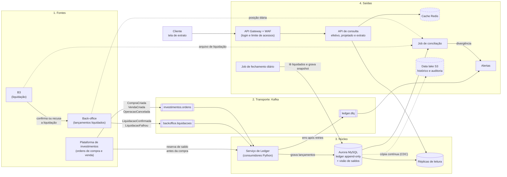
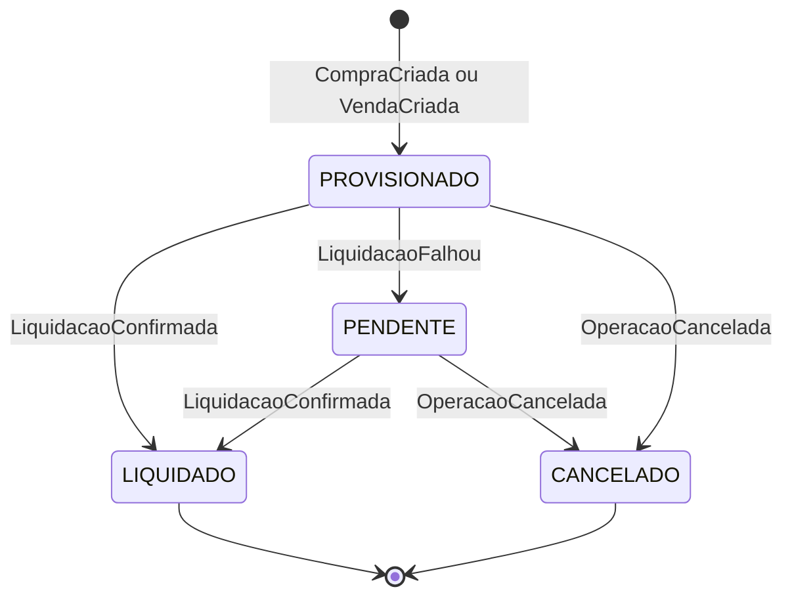
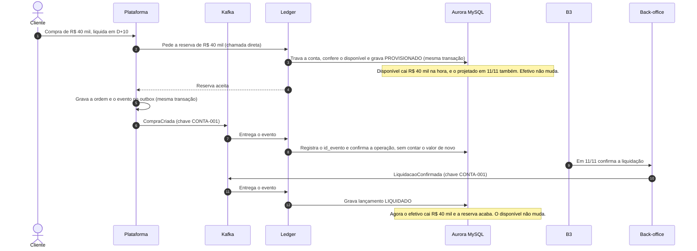
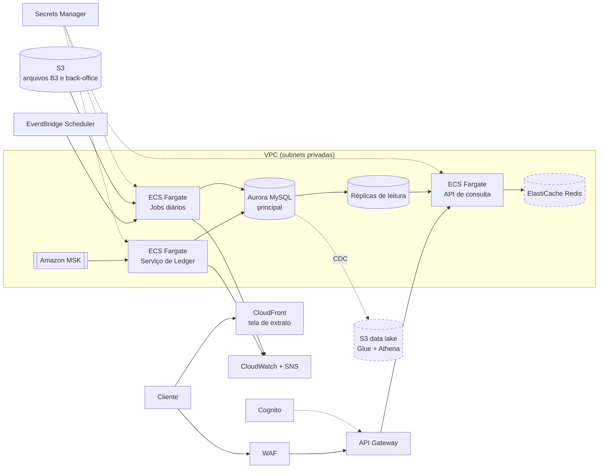

# 1. Arquitetura e integrações

Este documento mostra **quais peças existem**, **como elas conversam**, **onde cada uma roda na AWS** e **como a solução já nasce preparada para milhões de acessos**.

## 1.1 Visão geral em 4 camadas

Lendo da esquerda para a direita: quem gera a informação, por onde ela passa, onde ela é guardada e quem a consome.

Peças com **borda tracejada** são da fase 2 (escala). O desenho já reserva o lugar delas, mas o case funciona sem elas.



| Camada | O que faz | Peças |
|---|---|---|
| **1. Fontes** | Geram os fatos do negócio | Plataforma de investimentos, back-office, B3 |
| **2. Transporte** | Leva os fatos de forma durável e em ordem | Kafka (tópicos de ordens, liquidações e DLQ) |
| **3. Núcleo** | Transforma cada fato em lançamento contábil, sem duplicar | Serviço de Ledger + Aurora MySQL + réplicas de leitura |
| **4. Saídas** | Mostra, protege e confere os saldos | API Gateway + WAF, API de consulta, cache, fechamento, conciliação, data lake, alertas |

## 1.2 Os componentes, um por um

### Plataforma de investimentos (fonte)
É onde o cliente compra e vende. Cada ordem gera um evento com a **data de liquidação** prevista (D+0, D+10, D+30...).
Ela publica usando o **outbox pattern**: grava a ordem e o evento na mesma transação do banco dela, e um processo separado (o *relay*) envia o evento ao Kafka. Assim nunca acontece de a ordem existir sem o evento, nem o contrário. O detalhe fica na etapa 3.

### Back-office (fonte)
É quem registra o que **de fato liquidou**. Ele recebe da B3 a confirmação (ou a recusa) e publica `LiquidacaoConfirmada` ou `LiquidacaoFalhou`, também com outbox.

### B3 (integração externa)
Faz a liquidação. Não falamos com a B3 em tempo real: ela chega por dois caminhos:
1. Pelo back-office, que transforma a confirmação da B3 em evento.
2. Pelo **arquivo diário de liquidação**, que o job de conciliação usa como terceira fonte de conferência.

### Kafka (transporte)
É uma "esteira" de mensagens durável. Usamos por três motivos:
- **Desacopla:** a plataforma não precisa saber que o Ledger existe. Se o Ledger cair, as mensagens esperam na esteira.
- **Guarda histórico:** dá para "rebobinar" e reprocessar (replay).
- **Mantém ordem por conta:** toda mensagem usa **chave = `conta_id`**. Mensagens com a mesma chave caem na mesma partição, e dentro de uma partição a ordem é garantida. Então os eventos da `CONTA-001` são lidos na ordem em que foram publicados.

Tópicos:

| Tópico | Quem publica | Eventos |
|---|---|---|
| `investimentos.ordens` | Plataforma de investimentos | `CompraCriada`, `VendaCriada`, `OperacaoCancelada` |
| `backoffice.liquidacoes` | Back-office | `LiquidacaoConfirmada`, `LiquidacaoFalhou` |
| `ledger.dlq` | Serviço de Ledger | Mensagens que falharam mesmo depois dos retries |

### Serviço de Ledger (núcleo)
Um consumidor em Python que lê os dois tópicos e, para cada evento:
1. Valida o formato.
2. Abre uma transação no banco.
3. Grava o lançamento, marca o `id_evento` como processado e atualiza a **visão de saldos**, tudo junto. Se o `id_evento` já existir, o banco recusa e o evento é ignorado (idempotência).
4. Confirma a transação e só então avisa o Kafka que leu a mensagem (commit do offset).

Se o passo 3 falhar por um problema passageiro (banco fora do ar, por exemplo), ele tenta de novo com espera crescente (*backoff*). Se continuar falhando, manda a mensagem para a DLQ e segue em frente.

Várias cópias do Ledger rodam ao mesmo tempo, cada uma cuidando de um pedaço das partições (seção 1.7).

O Ledger também atende uma **chamada direta de reserva de saldo**, feita pela plataforma antes de aceitar uma compra. Numa única transação no banco principal, ele trava a conta por um instante, confere o saldo disponível e grava o lançamento `PROVISIONADO`. Sem saldo, a compra é recusada na hora. Uma reserva que não recebe o `CompraCriada` dentro do prazo expira e gera um estorno, para o dinheiro não ficar preso.

### Aurora MySQL (núcleo)
É a **fonte da verdade**. Guarda duas coisas:
- **Lançamentos:** tabela **append-only**, só recebe `INSERT`. É o "livro-razão" completo.
- **Visão de saldos:** tabela pronta para leitura, atualizada pelo Ledger na mesma transação. Assim, consultar o saldo não exige somar milhões de lançamentos.

O fechamento grava um snapshot por dia. As tabelas ficam na etapa 2.

### Tela de extrato (saída)
Uma tela web simples onde o cliente vê saldo efetivo, projetado e o extrato por período. Ela só conversa com a API, nunca com o banco.

### API Gateway + WAF (saída)
É a **porta de entrada** dos clientes. Antes de qualquer consulta chegar na nossa API, ela:
- confere se o cliente fez login (token válido);
- limita quantas requisições cada cliente pode fazer por segundo;
- bloqueia ataques comuns e excesso de acessos (WAF, o "firewall de aplicação").

### API de consulta (saída)
Responde quatro perguntas:
- Qual o **saldo disponível** da conta agora?
- Qual o **saldo efetivo** da conta numa data?
- Qual o **saldo projetado** da conta numa data futura?
- Qual o **extrato** de um período (saldo inicial, lançamentos e saldo final), com filtro Efetivo/Projetado?

Ela lê das **réplicas de leitura**, não do banco principal. Na fase 2, o saldo mais consultado fica em **cache (Redis)**.

### Job de fechamento diário (saída)
Roda uma vez por dia. Calcula `saldo_fechamento = saldo_anterior + liquidados do dia`, grava o snapshot e **trava o dia**. Evento atrasado não altera dia fechado: vira ajuste no dia seguinte (etapa 4).

### Job de conciliação (saída)
Roda depois do fechamento. Compara três visões do mesmo dia: **Ledger × back-office × B3**. Qualquer diferença vira um registro de divergência e um alerta (etapa 5).

### Data lake (saída, fase 2)
Uma cópia contínua dos lançamentos vai para o S3 em formato Parquet, organizada em camadas bronze, prata e ouro. Serve para auditoria, relatórios e extratos antigos, sem pesar no banco do dia a dia.

## 1.3 Os eventos

Todo evento usa o mesmo "envelope". Só o bloco `dados` muda de um tipo para outro.

```json
{
  "id_evento": "0b9f6c2e-4a51-4e0c-9d0a-6f1c2b7e8a10",
  "tipo": "CompraCriada",
  "versao_schema": 1,
  "origem": "plataforma-investimentos",
  "ocorrido_em": "2026-11-01T10:15:00-03:00",
  "conta_id": "CONTA-001",
  "operacao_id": "OP-0002",
  "dados": {
    "valor": "40000.00",
    "data_liquidacao": "2026-11-11"
  }
}
```

Por que cada campo existe:
- `id_evento`: gerado **na origem**. É ele que impede a duplicidade (UNIQUE no banco).
- `operacao_id`: liga todos os eventos da mesma operação (a compra, a liquidação e um eventual cancelamento).
- `conta_id`: também é a **chave da mensagem** no Kafka, para manter a ordem por conta.
- `ocorrido_em`: quando o fato aconteceu na origem, que é diferente de quando o Ledger recebeu.
- `versao_schema`: permite evoluir o formato sem quebrar quem já consome.
- `valor` como **texto** (`"40000.00"`): número em JSON costuma virar `float`, que perde centavos. O Ledger converte para `Decimal`.

| Evento | Origem | O que causa no Ledger |
|---|---|---|
| `CompraCriada` | Plataforma | Confirma a reserva já gravada como débito **PROVISIONADO**, sem contar o valor de novo |
| `VendaCriada` | Plataforma | Lançamento de crédito **PROVISIONADO** (muda o projetado) |
| `LiquidacaoConfirmada` | Back-office | Lançamento **LIQUIDADO** (muda o efetivo) |
| `LiquidacaoFalhou` | Back-office | Lançamento fica **PENDENTE** e gera alerta. O valor continua reservado. Nunca liquida "no chute" |
| `OperacaoCancelada` | Plataforma | **Estorno** do provisionado (status **CANCELADO**), e o valor volta ao disponível |

Ciclo de vida de um lançamento (cada seta é uma **nova linha** no ledger; o detalhe fica na etapa 3):



## 1.4 A vida de uma compra (exemplo da compra D+10)



E se a mesma mensagem chegar duas vezes (por exemplo, a rede caiu antes do Kafka receber a confirmação de leitura)? No passo 8 o banco recusa o `id_evento` repetido, o Ledger ignora e segue. O saldo não muda.

## 1.5 Onde cada peça roda na AWS

| Peça | Na prova de conceito (local) | Na AWS |
|---|---|---|
| Kafka | Container no docker-compose | **Amazon MSK** |
| Banco do ledger | Container MySQL no docker-compose | **Amazon Aurora MySQL**, em mais de uma zona, com réplicas de leitura |
| Serviço de Ledger | Processo Python | **ECS Fargate** (serviço sempre ligado, várias cópias) |
| Porta de entrada | — | **Amazon API Gateway** + **AWS WAF** |
| Login dos clientes | Sem login, acessível só no próprio computador | **Amazon Cognito** (ou o provedor de identidade do banco) |
| API de consulta | Processo Python | **ECS Fargate** |
| Tela de extrato | Página local | **S3 + CloudFront** |
| Fechamento e conciliação | Script Python | **ECS Fargate** (tarefa agendada) disparado pelo **EventBridge Scheduler** |
| Relay do outbox | Script Python que lê a tabela `outbox` | **MSK Connect** com Debezium (lê o outbox direto do log do banco) |
| Arquivos do back-office e da B3 | Valores simulados pela API | **Amazon S3** |
| Contrato dos eventos | Envelope único definido no código | **AWS Glue Schema Registry** |
| Senhas e conexões | Arquivo `.env` (fora do git) | **AWS Secrets Manager** |
| Criptografia | — | **AWS KMS** (Aurora, MSK e S3 criptografados) |
| Métricas, logs e alertas | Logs no terminal | **CloudWatch** (alarmes de fila atrasada e DLQ) + **SNS** |
| Trilha de quem acessou o quê | — | **CloudTrail** |
| Cache de saldos (fase 2) | — | **ElastiCache for Redis** |
| Data lake (fase 2) | — | **S3** (Parquet) + **Glue** + **Athena** |



## 1.6 Proteção

Pensando num banco com milhões de clientes, a proteção vem em camadas: se uma falhar, a próxima segura.

| Camada | Como protegemos |
|---|---|
| **Quem é o cliente** | Login com token (Cognito). O API Gateway recusa qualquer chamada sem token válido. |
| **O que ele pode ver** | A API confere se a conta pedida é a mesma do token. Um cliente nunca vê a conta de outro. |
| **Excesso de acessos e ataques** | WAF bloqueia padrões de ataque e IPs abusivos. O API Gateway limita requisições por cliente. |
| **Rede** | Só a porta de entrada é pública. Kafka, banco e serviços ficam em subnets privadas. |
| **Dados guardados e em trânsito** | Tudo criptografado: TLS na comunicação e KMS no Aurora, no MSK e no S3. |
| **Permissões mínimas** | Cada serviço só faz o que precisa. A plataforma só escreve em `investimentos.ordens`; o usuário de banco do Ledger tem só `INSERT` e `SELECT` nos lançamentos, então nem por engano consegue fazer `UPDATE` ou `DELETE`. |
| **Senhas** | Ficam no Secrets Manager, com troca automática. Nenhuma senha no código. |
| **Auditoria** | CloudTrail registra quem acessou o quê. Na fase 2, cada lançamento guarda o hash do anterior: se alguém alterar uma linha antiga direto no banco, a corrente quebra e a conciliação acusa. |

## 1.7 Preparado para escalar

Num banco, a maioria dos acessos é gente **consultando** saldo e extrato, e não fazendo operações. Por isso a escrita e a leitura escalam de formas diferentes. O detalhe e os números ficam na etapa 4.

**Escrita (eventos chegando):**
- Os tópicos do Kafka são divididos em várias partições, sempre pela chave `conta_id`.
- Várias cópias do Ledger leem em paralelo, cada uma com suas partições. Quando a fila começa a atrasar, o ECS liga mais cópias sozinho.
- A ordem por conta continua garantida, porque uma conta sempre cai na mesma partição.
- Se um único banco não der conta no futuro, o mesmo `conta_id` permite dividir as contas entre vários bancos (*sharding*).

**Leitura (clientes consultando):**
- A API lê das réplicas, então as consultas não disputam espaço com as gravações.
- A visão de saldos já vem pronta, sem somar lançamentos a cada consulta.
- Na fase 2, o cache Redis responde os saldos mais consultados em milissegundos.

**Histórico (dados crescendo):**
- A tabela de lançamentos é particionada por data, então consultas de um período não varrem tudo.
- Na fase 2, o histórico antigo vai para o data lake no S3. O banco do dia a dia continua enxuto.

## 1.8 Decisões desta etapa

**Por que eventos (Kafka) e não chamadas diretas (REST) entre os sistemas?**
Com chamada direta, se o Ledger estiver fora do ar a plataforma precisa guardar e reenviar tudo sozinha. Com o Kafka a mensagem fica guardada, o Ledger lê quando voltar e ainda dá para reprocessar o histórico. O custo é mais uma peça para operar, e o saldo fica atualizado em segundos, não no mesmo instante.

**Por que um tópico por sistema de origem, e não um tópico único?**
Cada sistema é dono do seu tópico, o que deixa permissões e formatos mais simples. Um tópico único não resolveria a ordem entre sistemas diferentes: a plataforma e o back-office publicam de forma independente, então a liquidação poderia chegar antes da compra de qualquer jeito. Por isso o Ledger trata esse caso explicitamente: se chegar uma liquidação de uma operação que ele ainda não conhece, ele **espera e tenta de novo**, e se persistir manda para a DLQ (etapa 5). A ordem que importa, a de eventos da mesma origem e da mesma conta, fica garantida pela chave `conta_id`.

**Por que Aurora MySQL e não RDS MySQL comum?**
Os dois falam MySQL, então o código é o mesmo. O Aurora aceita até 15 réplicas de leitura, o disco cresce sozinho e, se o servidor principal cair, outro assume em segundos. Para o argumento de "milhões de acessos" isso pesa. O custo é um pouco maior.

**Por que API Gateway + WAF na entrada?**
Login, limite de requisições por cliente e bloqueio de ataques já vêm prontos, em vez de serem programados dentro da nossa API. A API fica só com a regra de negócio. O custo são mais peças para configurar.

**Por que existe um saldo disponível, além do efetivo e do projetado?**
O case pede os dois saldos, mas eles não dizem quanto o cliente ainda pode gastar. Sem isso, o mesmo dinheiro poderia ser usado em duas compras e faltaria saldo na liquidação. Por isso, `disponível = efetivo - débitos provisionados ainda não liquidados`. Vendas a receber não entram, porque esse dinheiro ainda não chegou. No exemplo do case, em 01/11 o disponível é R$ 30 mil (70 mil de efetivo menos 40 mil reservados), e os números oficiais do efetivo e do projetado não mudam.

**Por que a reserva é uma chamada direta, e não um evento?**
A resposta precisa sair antes de a compra ser aceita, e duas compras simultâneas não podem usar o mesmo dinheiro. O custo é que a compra passa a depender do Ledger estar no ar: se ele cair, as compras param, mas o saldo nunca fica errado.

**Por que ECS Fargate e não Lambda?**
O Ledger é um consumidor que fica ligado o tempo todo e controla com cuidado quando confirma a leitura no Kafka; isso combina melhor com um serviço contínuo. Os jobs diários podem passar dos 15 minutos de limite da Lambda quando houver muitas contas. Usando ECS para tudo, temos **uma única imagem Python** com três pontos de entrada (ledger, API e jobs).

**Por que a B3 não fala direto com o Ledger?**
Quem tem o relacionamento com a B3 é o back-office. O Ledger só recebe fatos já confirmados. A B3 entra de novo como **terceira fonte** na conciliação, o que permite pegar erros do próprio back-office.

## 1.9 Fora do escopo

- O funcionamento interno da plataforma, do back-office e da B3. Aqui eles são apenas fontes de eventos e arquivos.
- Dias úteis e feriados (usamos dias corridos, como no case).
- Várias moedas: tudo é em reais.
- Aprovações manuais de operações, como assinatura ou análise de valores altos. Se existirem, acontecem antes de a plataforma pedir a reserva.
