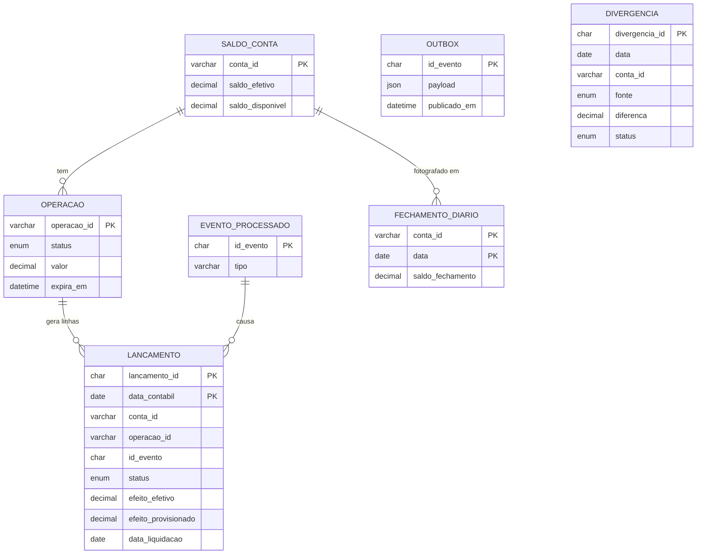

# 2. Modelo de dados

Este documento mostra **o que é guardado**, **como os saldos saem desses dados** e **por que o histórico não pode ser alterado**. O código das tabelas está em [`sql/schema.sql`](../sql/schema.sql).

## 2.1 A ideia central

A tabela `lancamento` é o livro-razão. Cada mudança de estado é uma **linha nova**, e nenhuma linha é alterada ou apagada.

Cada linha diz quanto ela mexe em dois "potes":

- `efeito_efetivo`: quanto entrou ou saiu de verdade.
- `efeito_provisionado`: quanto foi prometido e ainda não liquidou.

Assim, todo saldo é uma **soma simples**. Não é preciso descobrir qual é a última linha de cada operação.

| Mudança de estado | Compra de R$ 40 mil: efetivo / provisionado | Venda de R$ 20 mil: efetivo / provisionado |
|---|---|---|
| Entra como `PROVISIONADO` | 0 / −40 mil | 0 / +20 mil |
| Vira `LIQUIDADO` | −40 mil / +40 mil | +20 mil / −20 mil |
| Vira `CANCELADO` | 0 / +40 mil | 0 / −20 mil |
| Vira `PENDENTE` | 0 / 0 | 0 / 0 |

Repare que, ao liquidar, o valor **sai de um pote e entra no outro**. Em `PENDENTE` nada se move, então o valor continua reservado.

## 2.2 As tabelas



| Tabela | Para que serve | Pode mudar? |
|---|---|---|
| `lancamento` | O livro-razão, a fonte da verdade | **Nunca** |
| `fechamento_diario` | Foto do saldo no fim do dia. Existir linha significa que o dia está fechado | **Nunca** |
| `divergencia` | Diferenças achadas na conciliação com o back-office e a B3 | **Nunca** |
| `evento_processado` | Lista de eventos já tratados, para barrar repetidos | Só recebe linhas novas |
| `operacao` | Estado atual de cada operação, para validar a próxima mudança e expirar reservas | Sim, pode ser reconstruída |
| `saldo_conta` | Saldos prontos para leitura e ponto de trava da reserva | Sim, pode ser reconstruída |
| `outbox` | Eventos esperando publicação no Kafka | Só marca a publicação |

As tabelas `operacao` e `saldo_conta` são **atalhos**: tudo nelas pode ser recalculado a partir de `lancamento`. Se uma delas se perder, nada se perde de verdade.

A tabela `divergencia` é a prova de que a conferência aconteceu. Cada diferença vira uma linha `ABERTA`, com o valor do Ledger, o valor da outra fonte e a diferença. Quando alguém resolve, entra uma linha `RESOLVIDA` apontando para a original, e a primeira continua lá. Rodar a conciliação de novo não duplica a mesma diferença, e ela tem as mesmas proteções do livro-razão contra `UPDATE` e `DELETE`.

## 2.3 As quatro datas de um lançamento

| Campo | Pergunta que responde |
|---|---|
| `data_liquidacao` | Em que dia o dinheiro deve se mover? |
| `data_contabil` | Em que dia esta linha conta no saldo? |
| `ocorrido_em` | Quando o fato aconteceu na origem? |
| `registrado_em` | Quando o ledger ficou sabendo? |

Normalmente elas caem no mesmo dia. Elas se separam quando algo atrasa, e é isso que resolve o evento atrasado (seção 2.6).

## 2.4 Como cada saldo é calculado

```sql
-- Efetivo em uma data
SELECT SUM(efeito_efetivo)
FROM lancamento
WHERE conta_id = 'CONTA-001' AND data_contabil <= '2026-11-01';

-- Projetado em uma data: efetivo de hoje + o que liquida até a data pedida
SELECT (SELECT SUM(efeito_efetivo)
        FROM lancamento
        WHERE conta_id = 'CONTA-001' AND data_contabil <= CURRENT_DATE)
     + (SELECT COALESCE(SUM(efeito_provisionado), 0)
        FROM lancamento
        WHERE conta_id = 'CONTA-001' AND data_liquidacao <= '2026-12-01');

-- Disponível agora
SELECT saldo_disponivel FROM saldo_conta WHERE conta_id = 'CONTA-001';
```

O disponível é `efetivo + débitos provisionados`. Como os débitos ficam negativos nesse pote, a soma já desconta as compras reservadas. Vendas a receber ficam em outra coluna e não entram na conta.

## 2.5 O exemplo do case, linha por linha

| # | Operação | Status | Efetivo | Provisionado | Liquida em | Conta em |
|---|---|---|---|---|---|---|
| 1 | Saldo inicial | `LIQUIDADO` | +100.000 | 0 | 31/10 | 31/10 |
| 2 | Compra de 30 mil | `PROVISIONADO` | 0 | −30.000 | 01/11 | 01/11 |
| 3 | Compra de 30 mil | `LIQUIDADO` | −30.000 | +30.000 | 01/11 | 01/11 |
| 4 | Compra de 40 mil | `PROVISIONADO` | 0 | −40.000 | 11/11 | 01/11 |
| 5 | Venda de 20 mil | `PROVISIONADO` | 0 | +20.000 | 01/12 | 01/11 |
| 6 | Compra de 40 mil | `LIQUIDADO` | −40.000 | +40.000 | 11/11 | 11/11 |
| 7 | Venda de 20 mil | `LIQUIDADO` | +20.000 | −20.000 | 01/12 | 01/12 |

| Olhando em 01/11 (linhas 1 a 5) | Conta | Resultado |
|---|---|---|
| Efetivo em 01/11 | 100 − 30 | **70 mil** |
| Disponível | 70 − 40 | **30 mil** |
| Projetado em 11/11 | 70 − 40 | **30 mil** |
| Projetado em 01/12 | 70 − 40 + 20 | **50 mil** |

## 2.6 Evento atrasado

O dia 11/11 foi fechado, mas a confirmação da compra de 40 mil só chegou no dia 12/11:

1. O ledger vê que já existe linha em `fechamento_diario` para 11/11.
2. Grava o lançamento com `data_contabil` em 12/11, o primeiro dia aberto, apontando para a linha original em `lancamento_ref_id`.
3. O fechamento de 11/11 continua igual, e a diferença aparece no dia 12/11 como ajuste.

As colunas `ocorrido_em` e `registrado_em` guardam o que realmente aconteceu, então a auditoria consegue explicar o atraso.

## 2.7 Extrato por período

1. **Saldo inicial:** `saldo_fechamento` do dia anterior ao início, em `fechamento_diario`.
2. **Lançamentos:** linhas com `efeito_efetivo` diferente de zero e `data_contabil` no período.
3. **Saldo final:** saldo inicial mais os lançamentos.

No filtro **Projetado**, entram também as operações em aberto de `operacao`, marcadas como "a liquidar em 11/11". As que estão em `PENDENTE` aparecem como "em análise".

## 2.8 Como o banco garante que nada muda

São três barreiras independentes:

| Barreira | O que faz |
|---|---|
| **Triggers** | Recusam qualquer `UPDATE` ou `DELETE` em `lancamento` e `fechamento_diario`, mesmo vindo de quem tem permissão |
| **Permissões** | O papel `ledger_app` só tem `SELECT` e `INSERT` no livro-razão. Sem permissão, também não consegue usar `TRUNCATE`, que não aciona triggers |
| **Correção por estorno** | O caminho oficial para corrigir um erro é gravar uma linha nova apontando para a original |

Um administrador do banco ainda teria poder para mexer na estrutura. Por isso, esse acesso fica restrito e auditado, e o hash encadeado previsto na fase 2 serve para detectar esse tipo de alteração.

## 2.9 Decisões desta etapa

**Por que `DECIMAL` e não número inteiro em centavos?**
Os dois são exatos. `DECIMAL(18,2)` deixa o valor legível numa consulta (`40000.00`), o que ajuda na auditoria. `FLOAT` está fora de questão, porque arredonda centavos.

**Por que `evento_processado` é uma tabela separada?**
No MySQL, numa tabela particionada, toda chave única precisa incluir a coluna de partição. Com `id_evento` único dentro de `lancamento`, o mesmo evento poderia entrar em dois dias diferentes. Na tabela separada, a garantia vale para sempre.

**Por que não há chaves estrangeiras em `lancamento`?**
O MySQL não aceita chave estrangeira em tabela particionada. A ligação entre as tabelas é garantida pela transação do Ledger e conferida na conciliação.

**Por que as tabelas `operacao` e `saldo_conta`, que não estavam no plano inicial?**
A `operacao` responde rápido "qual o estado atual?", necessário para recusar uma transição inválida, como cancelar algo já liquidado, e para encontrar reservas vencidas. A `saldo_conta` evita somar o histórico a cada consulta e dá à reserva uma linha para travar.

**Por que particionar por `data_contabil`?**
O extrato busca por período, então o banco lê só os meses necessários. As partições precisam ser criadas com antecedência; a partição `p_futuro` evita erro caso alguma falte.

## 2.10 Evolução prevista

Esta versão trata só de investimentos. Movimentações como Pix, TED e salário usam as mesmas tabelas: entram como uma linha já `LIQUIDADO`, e um Pix de saída respeita o saldo disponível. Para isso, faltam um evento novo (por exemplo, `MovimentacaoLiquidada`) e um novo valor em `tipo`.
