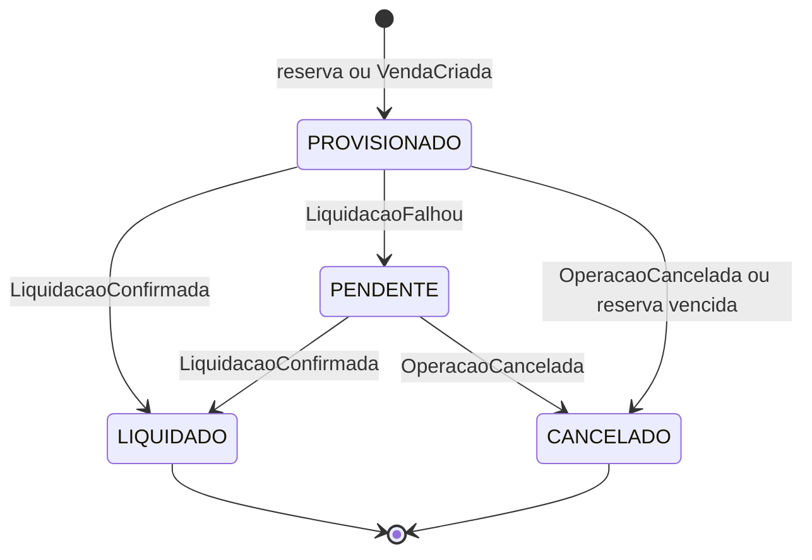

# 3. Consistência e idempotência

Este documento mostra **como o saldo continua certo quando as coisas dão errado**. A premissa é que falhas vão acontecer: a rede cai, o Kafka repete mensagens e eventos atrasam. Por isso, a garantia não depende de uma entrega perfeita. Ela está no banco.

## 3.1 Visão geral

| Problema | Solução | Onde fica |
|---|---|---|
| O evento se perde | Outbox pattern | Banco de quem publica |
| O evento chega duas vezes | `id_evento` único, na mesma transação do lançamento | `evento_processado` |
| Os eventos chegam fora de ordem | Chave `conta_id` no Kafka, e retry para o que ainda não é conhecido | Kafka e Ledger |
| Uma mudança de estado impossível | Máquina de estados | `operacao` e Ledger |
| Duas compras usam o mesmo dinheiro | Trava da linha da conta (*lock*) | `saldo_conta` |

## 3.2 Não perder eventos: outbox

Sem cuidado, o sistema poderia salvar a compra e cair antes de avisar o Kafka. Com o outbox, a compra e o aviso são gravados **na mesma transação**. Um processo separado (o *relay*) lê a tabela `outbox`, envia ao Kafka e marca `publicado_em`.

Se o relay cair depois de enviar e antes de marcar, o evento será enviado de novo. Isso é esperado, e a idempotência resolve.

## 3.3 Não contar duas vezes: idempotência

O Kafka trabalha com entrega **at-least-once** (pelo menos uma vez). A solução combina duas regras:

1. O `id_evento` é gravado em `evento_processado` **na mesma transação** do lançamento. Se já existir, o banco recusa e nada muda.
2. A confirmação de leitura ao Kafka (**commit do offset**) só acontece **depois** do commit no banco. Se o Ledger cair entre os dois, a mensagem volta e a regra 1 barra.

O Kafka pode entregar duas vezes, mas o efeito no saldo acontece uma vez só.

```sql
START TRANSACTION;

-- Evento repetido: erro de chave duplicada, ROLLBACK e segue para o próximo.
INSERT INTO evento_processado (id_evento, tipo, conta_id) VALUES (?, ?, ?);

-- Sempre trava primeiro a conta e depois a operação, para evitar deadlock.
SELECT saldo_disponivel FROM saldo_conta WHERE conta_id = ? FOR UPDATE;
SELECT status FROM operacao WHERE operacao_id = ? FOR UPDATE;

-- O Ledger confere se a transição é permitida (seção 3.5).
INSERT INTO lancamento (...) VALUES (...);
UPDATE operacao SET status = ? WHERE operacao_id = ?;
UPDATE saldo_conta SET ... WHERE conta_id = ?;

COMMIT;
-- Só depois disso o Ledger faz o commit do offset no Kafka.
```

## 3.4 Ordem dos eventos

Mensagens com a mesma chave `conta_id` caem na mesma partição, e nela a ordem é garantida. Entre tópicos diferentes não há essa garantia. A reserva resolve boa parte do problema, porque a compra já existe no Ledger antes de qualquer evento.

| Situação | O que o Ledger faz |
|---|---|
| `CompraCriada` chega depois da liquidação | Aceita, porque só confirma a compra |
| Liquidação de uma venda ainda desconhecida | Retry com espera crescente. Se não resolver, vai para a DLQ |

## 3.5 Máquina de estados

O `id_evento` barra a mesma mensagem repetida, mas não barra duas mensagens diferentes dizendo coisas incompatíveis. Quem faz isso é a máquina de estados.



Cada seta grava uma **nova linha** em `lancamento` e atualiza `operacao`. Qualquer caminho fora do desenho é recusado:

| Caso | O que acontece |
|---|---|
| Mesmo `id_evento` de novo | Ignorado em silêncio. É o comportamento normal |
| Segunda liquidação com outro ID | Transição inválida: nada é gravado, vai para a DLQ e gera alerta |
| Liquidar uma operação cancelada | Transição inválida: nada é gravado, vai para a DLQ e gera alerta |
| Cancelar uma operação já liquidada | Recusado com alerta. O dinheiro já se moveu, então uma pessoa analisa e corrige com um lançamento de `AJUSTE` |

## 3.6 Reserva de saldo

```sql
START TRANSACTION;

INSERT INTO evento_processado (id_evento, tipo, conta_id) VALUES (?, 'ReservaSolicitada', ?);

SELECT saldo_disponivel FROM saldo_conta WHERE conta_id = ? FOR UPDATE;
-- Se o disponível for menor que o valor: ROLLBACK e compra recusada.

INSERT INTO operacao (...) VALUES (...);    -- status PROVISIONADO, expira em 15 minutos
INSERT INTO lancamento (...) VALUES (...);  -- efeito_provisionado negativo
UPDATE saldo_conta SET provisionado_debitos = provisionado_debitos - ? WHERE conta_id = ?;

COMMIT;
```

**Duas compras ao mesmo tempo:** a primeira tranca a linha da conta. A segunda espera, enxerga o disponível já reduzido e é recusada se não houver saldo.

**Pedido repetido:** o mesmo pedido de reserva não reserva duas vezes, porque tem um ID único. Como uma reserva recusada desfaz a transação, uma nova tentativa é avaliada de novo, já com o saldo do momento.

**Reserva vencida:** o normal é o `CompraCriada` chegar em segundos. Um job procura operações `PROVISIONADO` sem `confirmada_em` e com `expira_em` no passado, grava o estorno e devolve o valor ao disponível. Se o `CompraCriada` chegar depois disso, ele é recusado com alerta, porque o dinheiro já pode ter sido usado em outra compra.

## 3.7 Decisões desta etapa

**Por que recusar o cancelamento de uma operação já liquidada?**
O dinheiro já se moveu. Um estorno automático devolveria dinheiro sem ninguém olhar. A contrapartida é depender de uma pessoa nesses casos, que devem ser raros.

**Por que a reserva vence em 15 minutos?**
Cobre uma instabilidade sem prender o dinheiro do cliente por muito tempo. Com um prazo maior, haveria mais folga, mas o dinheiro ficaria preso por mais tempo em caso de falha.

**Por que trava pessimista (`FOR UPDATE`) e não otimista?**
Na trava otimista, as duas compras tentam gravar e uma delas refaz o trabalho. Ela funciona bem quando conflitos são raros. Aqui, a trava pessimista é mais simples de garantir e vale só para uma conta, por um instante, sem atrapalhar as demais.

## 3.8 O que já foi comprovado

| Garantia | Situação |
|---|---|
| `id_evento` repetido recusado | Testado no MySQL |
| Livro-razão sem `UPDATE` e `DELETE` | Testado no MySQL |
| Trava com compras simultâneas | A validar na prova de conceito |
| Máquina de estados e reserva vencida | A validar na prova de conceito |
| Outbox e reentrega pelo Kafka | A validar na prova de conceito |
