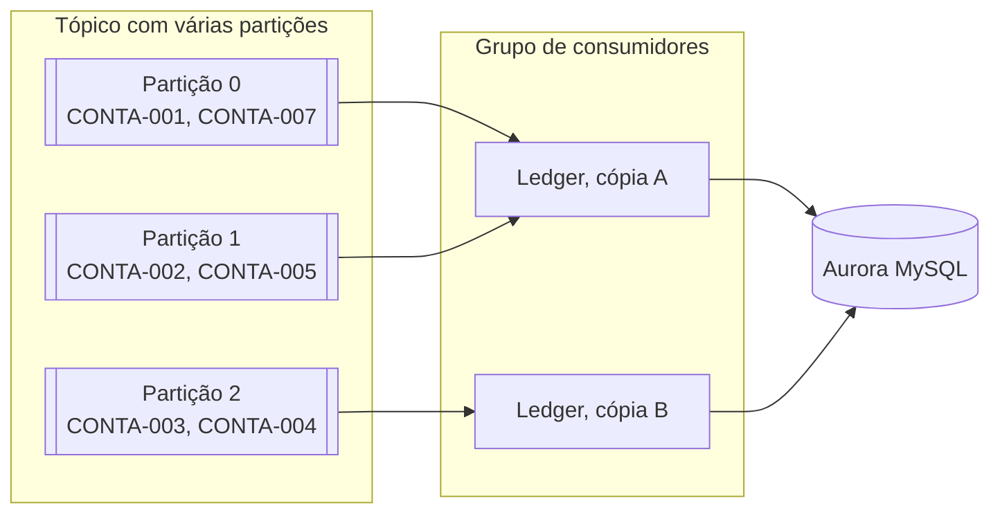

# 4. Escalabilidade e fechamento diário

Este documento mostra **como a solução cresce para milhões de clientes** e **como o dia é fechado sem travar o sistema**.

## 4.1 O ponto de partida

Num banco, escrever e consultar são problemas diferentes. Há muito mais gente olhando o saldo do que fazendo operações. Por isso, cada caminho cresce do seu jeito.

Uma conta simples ajuda a dar ordem de grandeza. É um **exemplo hipotético**, não uma medição:

| Cenário | Conta | Resultado |
|---|---|---|
| 1 milhão de eventos por dia, espalhados | 1.000.000 ÷ 86.400 segundos | cerca de 12 por segundo |
| Pico de 10 vezes a média | 12 × 10 | cerca de 120 por segundo |

Os números reais precisam vir de um teste de carga, previsto para a fase 2.

## 4.2 Escrita: mais eventos chegando



- **Partições:** cada tópico é dividido em filas menores, e a chave `conta_id` define a fila de cada conta.
- **Grupo de consumidores:** cada partição é lida por uma só cópia do Ledger por vez. Com mais cópias, mais partições são lidas em paralelo.
- **Ordem preservada:** como uma conta fica sempre na mesma partição, seus eventos continuam em ordem.
- **Escala automática:** quando a fila começa a atrasar (o *consumer lag* cresce), o ECS liga mais cópias.

Dois limites importantes:

- O número de partições é o teto de cópias trabalhando ao mesmo tempo.
- Aumentar partições depois muda o destino de algumas contas e pode embaralhar a ordem naquele momento. Por isso, o número é definido com folga desde o início.

A trava da reserva não vira gargalo geral, porque vale só para **uma linha de uma conta**, por um instante.

## 4.3 Leitura: mais gente consultando

| Camada | O que resolve |
|---|---|
| `saldo_conta` | O saldo já vem pronto, sem somar o histórico |
| Réplicas de leitura | Consultas não disputam espaço com as gravações |
| Cache Redis (fase 2) | Os saldos mais consultados respondem em milissegundos |

A réplica recebe os dados com um pequeno atraso. Isso é aceitável para **mostrar** um saldo, mas não para **decidir** sobre dinheiro. Por isso, a reserva sempre consulta o **banco principal**.

## 4.4 Dados crescendo

- **Partição por mês:** `lancamento` é dividida por `data_contabil`, e o extrato lê só os meses pedidos.
- **Data lake (fase 2):** uma cópia contínua vai para o S3 em Parquet, para auditoria e relatórios. Só depois disso os dados antigos podem sair do banco principal.
- **Sharding (futuro):** se um único banco não der conta, as contas são divididas entre vários bancos pelo `conta_id`. Todas as tabelas já têm essa coluna, e a transação de uma conta nunca depende de outra.

## 4.5 Fechamento diário

Depois da meia-noite, o job calcula o dia anterior para cada conta:

```
saldo_fechamento = saldo_anterior + soma dos efeitos efetivos do dia
```

Cada conta é fechada em uma transação própria:

```sql
START TRANSACTION;

-- Trava a conta: nenhum lançamento entra enquanto o dia dela é fechado.
SELECT saldo_efetivo FROM saldo_conta WHERE conta_id = ? FOR UPDATE;

SELECT saldo_fechamento FROM fechamento_diario
WHERE conta_id = ? AND data = ?;   -- dia anterior

SELECT COALESCE(SUM(efeito_efetivo), 0) FROM lancamento
WHERE conta_id = ? AND data_contabil = ?;   -- dia que está fechando

INSERT INTO fechamento_diario (conta_id, data, saldo_anterior, total_liquidado, saldo_fechamento)
VALUES (?, ?, ?, ?, ?);

COMMIT;
```

| Preocupação | Como é tratada |
|---|---|
| Muitas contas | Várias tarefas em paralelo, cada uma com uma faixa de contas |
| Sistema parado durante o fechamento | Não para: só a conta do momento fica travada, por um instante |
| Job caiu no meio | Basta rodar de novo. Quem já fechou é pulado, e a chave primária impede duplicar o dia |
| Evento chega depois | Vira ajuste no primeiro dia aberto (seção 2.6) |

**Limite conhecido:** esta versão grava uma linha por conta por dia, mesmo sem movimento. Com muitos milhões de contas, a evolução natural é gravar só as contas que se moveram e controlar o fechamento do dia em uma tabela própria.

## 4.6 Decisões desta etapa

**Por que escalar por conta, e não por cliente ou por produto?**
A conta é a unidade em que o saldo precisa ser correto. Tudo que precisa de ordem e de trava acontece dentro de uma conta.

**Por que fechar conta por conta, e não tudo em uma transação?**
Uma transação gigante travaria o banco e, se falhasse, perderia todo o trabalho. Conta por conta, a falha afeta só o que faltava.
