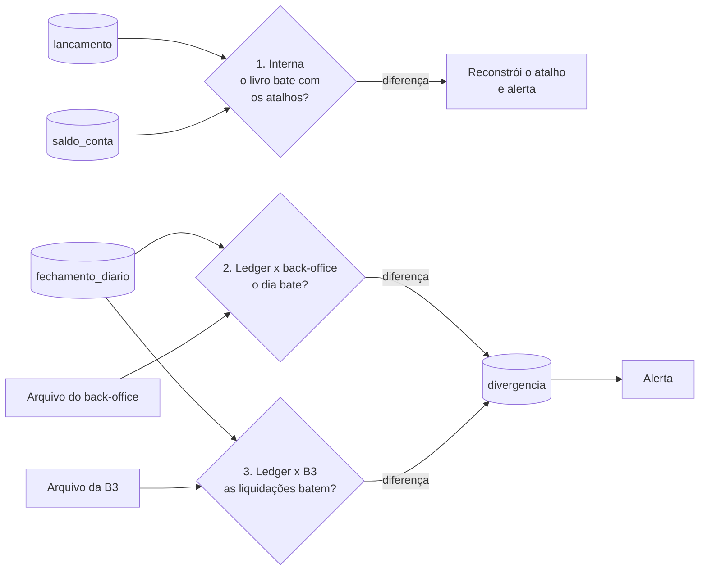

# 5. Resiliência, reprocessamento e conciliação

Este documento mostra **o que acontece quando algo quebra**, **como refazer o trabalho sem duplicar** e **como provar que os saldos estão certos**.

## 5.1 Retry e DLQ

Nem todo erro é igual:

| Tipo de erro | Exemplo | O que o Ledger faz |
|---|---|---|
| **Passageiro** | Banco reiniciando, rede instável | Tenta de novo com espera crescente (*backoff*) |
| **Dependência** | Liquidação de uma venda ainda desconhecida | Tenta de novo por mais tempo |
| **Permanente** | Formato inválido, transição proibida | Vai direto para a DLQ |

Mensagens em `ledger.dlq` levam junto o erro, o tópico, a partição e o offset originais. Qualquer mensagem na DLQ gera alerta. Depois de corrigir a causa, a mensagem é publicada de novo no tópico original.

**Cuidado com a ordem:** se um evento de uma conta for para a DLQ e os seguintes continuarem, eventos da mesma operação vão encontrar um estado inesperado. A máquina de estados os recusa, e eles também ficam disponíveis para reprocessamento, em vez de gravar algo errado.

## 5.2 Reprocessamento

Como tudo é idempotente, repetir o trabalho não duplica nada. Há dois caminhos:

| Caminho | Quando usar | Como funciona |
|---|---|---|
| **Replay do Kafka** | O Ledger ficou fora ou um bug descartou eventos | Volta o offset do grupo de consumidores. Eventos já tratados são barrados pelo `id_evento` |
| **Reconstrução pelo ledger** | `saldo_conta` ou `operacao` ficaram erradas | Recalcula a partir de `lancamento`, que é a fonte da verdade |

```sql
-- Como saldo_conta deveria estar, calculado direto do livro-razão
SELECT conta_id,
       SUM(efeito_efetivo) AS saldo_efetivo,
       SUM(CASE WHEN natureza = 'DEBITO'  THEN efeito_provisionado ELSE 0 END) AS provisionado_debitos,
       SUM(CASE WHEN natureza = 'CREDITO' THEN efeito_provisionado ELSE 0 END) AS provisionado_creditos
FROM lancamento
GROUP BY conta_id;
```

O replay só alcança o que o Kafka ainda guarda. Por isso, a retenção dos tópicos precisa ser maior que o tempo de detectar e corrigir um problema. Para o que for mais antigo, a fonte é o próprio ledger.

## 5.3 O que acontece em cada falha

| O que falhou | O que acontece | Como volta |
|---|---|---|
| Uma cópia do Ledger | As partições dela passam para outra cópia | Sozinho. Mensagens sem confirmação são relidas, sem duplicar |
| Todo o Ledger | Eventos esperam no Kafka. **Novas compras são recusadas**, porque não há como reservar | Ao voltar, lê o que acumulou |
| Kafka | Eventos esperam no outbox de cada sistema | O relay envia quando o Kafka voltar |
| Banco principal | Uma réplica assume em segundos. O Ledger tenta de novo durante a troca | Automático |
| Back-office ou B3 sem confirmar | A operação continua `PROVISIONADO` depois da data e o valor segue reservado | A conciliação alerta. Nunca liquida "no chute" |
| Job de fechamento | Dias ficam sem fechar e o alarme dispara | Rodar de novo. Só faz o que faltou |
| Arquivo de conciliação não chegou | Não é possível conferir aquele dia e o alarme dispara | Rodar a conciliação quando o arquivo chegar |
| Zona inteira da AWS | Serviços em outra zona assumem | Automático, por rodar em mais de uma zona |

## 5.4 Conciliação

Roda todo dia, depois do fechamento, em três níveis:



| Nível | O que compara | Se não bater |
|---|---|---|
| **1. Interna** | Soma de `lancamento` × `saldo_conta` | O atalho é reconstruído, porque o livro é a verdade, e gera alerta |
| **2. Back-office** | Total liquidado por conta e dia | Linha `ABERTA` em `divergencia` |
| **3. B3** | Liquidações por conta e dia | Linha `ABERTA` em `divergencia` |

A tolerância é **zero**: um centavo de diferença já vira divergência. O sistema **não corrige sozinho** uma diferença com fonte externa, porque não sabe quem está certo. Uma pessoa analisa e, se for o caso, registra um `AJUSTE` e uma linha `RESOLVIDA`.

Operações com data de liquidação vencida e ainda sem confirmação também entram no relatório de alertas.

## 5.5 Alarmes

| Alarme | Por que importa |
|---|---|
| *Consumer lag* crescendo | O Ledger não está dando conta |
| Mensagem na DLQ | Algum evento não foi aplicado |
| Divergência aberta | Os saldos não batem com uma fonte externa |
| Fechamento não terminou no horário | Dias abertos atrasam o extrato e a conciliação |
| Arquivo de conciliação ausente | Um dia ficou sem conferência |
| Muitas reservas vencendo | Provável problema no fluxo de compra |

## 5.6 Decisões desta etapa

**Por que não corrigir divergências automaticamente?**
Numa diferença com o back-office ou a B3, o sistema não sabe quem errou. Corrigir sozinho poderia esconder o problema ou criar um erro novo.

**Por que recusar compras quando o Ledger cai?**
Sem o Ledger, não há como garantir que o dinheiro existe. Entre ficar indisponível por um tempo e correr o risco de gastar o mesmo dinheiro duas vezes, a escolha é ficar indisponível.
